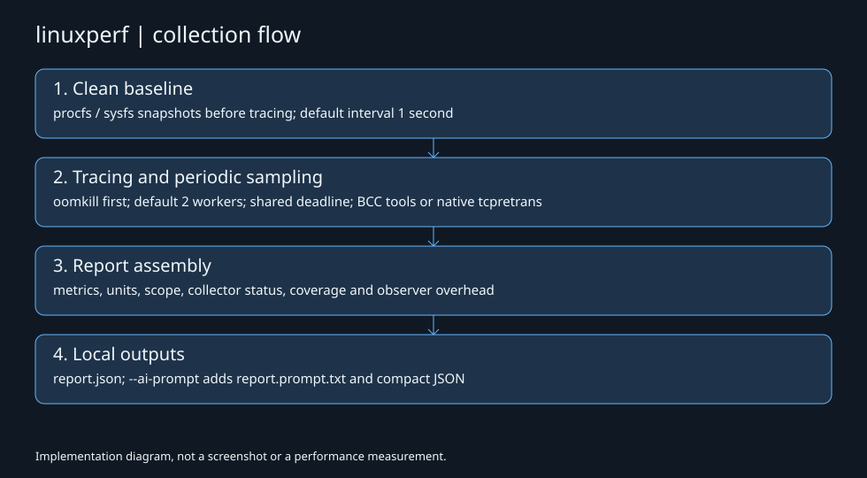

# Introduction to linuxperf

linuxperf is a single-file Linux diagnostic tool using Python 3.8+ and its standard library. Deploy `linuxperf.py`; no application build or Python package installation is required. Measurements describe the visible host, process or cgroup scope rather than necessarily the whole physical machine.

The USE method examines utilization, saturation and errors. Reports contain `metadata`, `categories`, `metrics`, `metric_specs`, `time_series`, `summary` and `source_errors`. A null value means unknown. Read collector status and coverage before interpreting anomalies or recommendations.

Backends include procfs/sysfs, external BCC/system tools and native eBPF for tcpretrans. They are named backends, not numeric tiers. Permissions and kernel support affect availability. Collect neither installs packages nor applies tuning.



```bash
python3 linuxperf.py capabilities
```

Implementation: [linuxperf.py](../../linuxperf.py) — `collect`, `result`.

[Contents](00-chapters.md) · [README](../../README.md) · [Русский](../ru/00-introduction.md)
