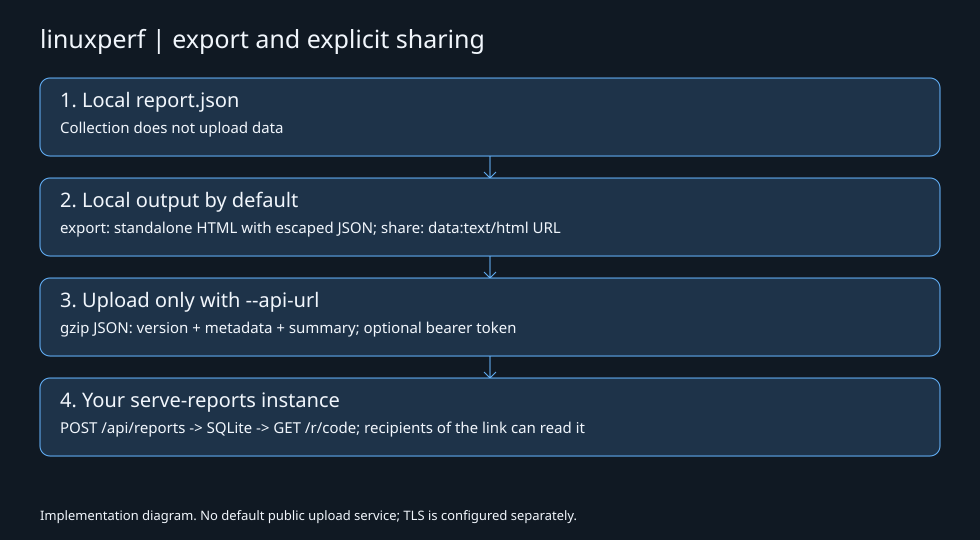

# Exporting and sharing

Share defaults to a locally generated data:text/html URL containing base64 HTML with the full report. It is neither a public short-link service nor fragment fallback. URLs may be large; HTML export is often easier for file sharing.

Only an explicit api-url sends POST. The gzip JSON payload contains version=1, metadata and summary, excluding categories and detailed events. Offline forces local generation. There is no default public upload service or automatic public fallback.

Serve-reports uses SQLite, serves /r/code and accepts POST /api/reports. Defaults are loopback bind, port 8787 and TTL 604800 seconds. Non-loopback binding requires token and public-url; configure TLS separately. A configured bearer token protects POST; GET /r/code does not require it, so link recipients can view data. The viewer displays escaped JSON rather than a graphical dashboard.



```bash
python3 linuxperf.py export report.json --format html -o report.html
python3 linuxperf.py share report.json --offline -o report-url.txt
python3 linuxperf.py serve-reports --port 8787 --storage linuxperf-reports.sqlite --token example-token
# In another terminal:
python3 linuxperf.py share report.json --api-url http://127.0.0.1:8787/api/reports --token example-token
```

Implementation: [linuxperf.py](../../linuxperf.py) — `share_report`, `serve_reports`, `export`.

[Contents](00-chapters.md) · [README](../../README.md) · [Русский](../ru/22-sharing.md)
