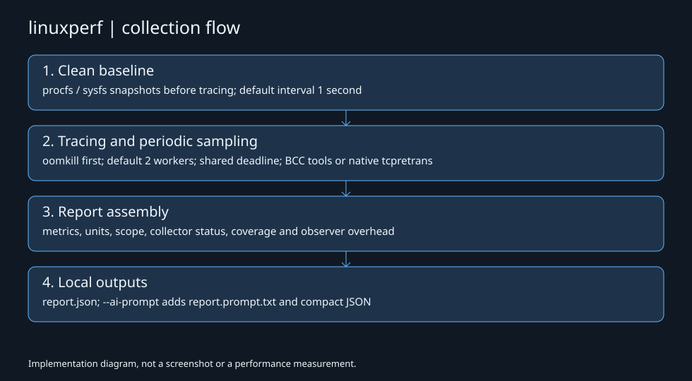

# Введение в linuxperf

linuxperf — однофайловая диагностика Linux на Python 3.8+ со стандартной библиотекой. Для запуска нужен `linuxperf.py`; компиляция приложения и установка Python-пакетов не требуются. Метрики описывают видимую область хоста, процесса или cgroup, а не обязательно всю физическую машину.

Метод USE рассматривает использование, насыщение и ошибки ресурсов. JSON содержит `metadata`, `categories`, `metrics`, `metric_specs`, `time_series`, `summary`, `source_errors`. Значение `null` означает отсутствие измерения. Сначала читайте статусы и coverage, затем аномалии и рекомендации.

Источники: procfs/sysfs, внешние BCC и системные команды, встроенный eBPF для tcpretrans. Это значения `backend`, а не числовые уровни tier. Права и поддержка ядра могут ограничивать любой источник. Collect не устанавливает пакеты и не применяет настройки.



```bash
python3 linuxperf.py capabilities
```

Реализация: [linuxperf.py](../../linuxperf.py) — `collect`, `result`.

[Оглавление](00-chapters.md) · [README](../../README.md) · [English](../en/00-introduction.md)
