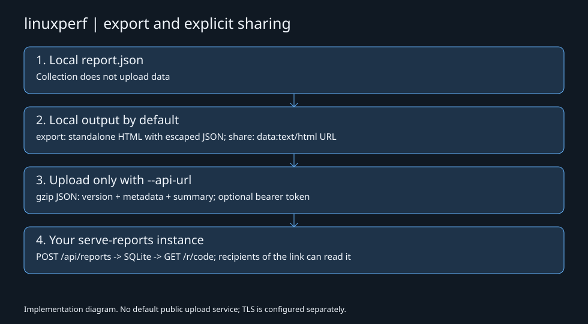

# Экспорт и публикация

По умолчанию share создаёт автономный data:text/html URL локально. Это base64 HTML с полным отчётом, а не короткая ссылка на публичный сайт и не fragment fallback. Такой URL может быть большим; экспорт в HTML удобнее для пересылки файла.

Только явно заданный --api-url вызывает POST. Передаются version=1, metadata и summary в gzip JSON; categories и подробные события в этот payload не включаются. --offline принудительно выбирает локальный путь. Нет встроенного публичного сервиса по умолчанию и автоматического перехода на него.

Serve-reports хранит payload в SQLite, выдаёт /r/code и принимает POST /api/reports. Default bind=127.0.0.1, port=8787, ttl=604800 s. Для нелокального bind нужны token и public-url, TLS настраивается отдельно. Bearer token защищает POST при его задании; доступ к /r/code не требует token, получатель ссылки видит данные. Нет обещания отдельного графического dashboard: страница показывает экранированный JSON.



```bash
python3 linuxperf.py export report.json --format html -o report.html
python3 linuxperf.py share report.json --offline -o report-url.txt
python3 linuxperf.py serve-reports --port 8787 --storage linuxperf-reports.sqlite --token example-token
# In another terminal:
python3 linuxperf.py share report.json --api-url http://127.0.0.1:8787/api/reports --token example-token
```

Реализация: [linuxperf.py](../../linuxperf.py) — `share_report`, `serve_reports`, `export`.

[Оглавление](00-chapters.md) · [README](../../README.md) · [English](../en/22-sharing.md)
